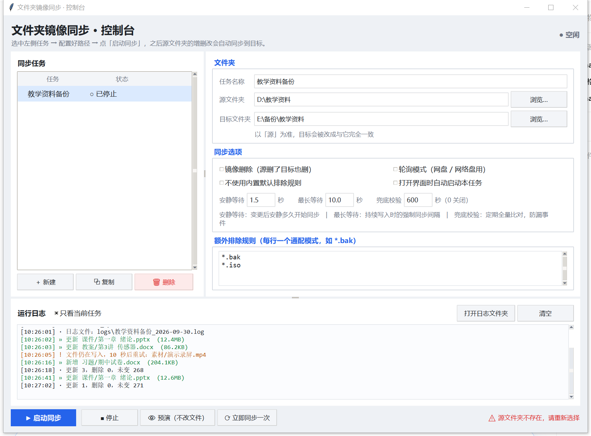

# folder-mirror

**一个纯 Python 标准库实现的实时文件夹镜像同步工具。零第三方依赖。**

把一个文件夹的内容**实时**保持到另一个文件夹，一切以源为准。改完文件 1~2 秒内自动同步过去，适合本机双盘备份、外置硬盘同步、网盘挂载盘备份等场景。

<p align="center">
  
</p>

---

## 特性

| 特性 | 说明 |
|---|---|
| **真正实时** | Windows 下调用系统原生 `ReadDirectoryChangesW` 事件接口，零轮询开销，改完即同步 |
| **零依赖** | 只用 Python 标准库，不需要 `pip install` 任何东西 |
| **双形态** | 带图形配置界面，也能纯命令行运行 / 挂计划任务 |
| **原子写入** | 先写 `.mstmp` 临时文件再改名，目标端**永远不会出现半截文件** |
| **写入稳定检测** | 源文件还在被写入时先不下手，不会复制到不完整的文件 |
| **删除默认关闭** | 不加 `--delete` 时只增不删，防止误删扩散到目标 |
| **预演模式** | `--dry-run` 只打印打算做什么，不碰任何文件 |
| **多任务管理** | 图形界面里可建多个任务，各自独立启停、独立看日志 |
| **自动降级** | 非 Windows 或事件接口不可用时自动切换为定时轮询 |

---

## 快速开始

### 环境要求

- Python 3.10 或更高版本
- Windows / macOS / Linux（图形界面需 `tkinter`，官方安装包默认自带）

### 方式一：图形界面（推荐新手）

双击 **`启动图形界面.bat`**（Windows），或在终端运行：

```bash
python mirror_gui.py
```

然后：

1. 左栏点「**＋ 新建**」建一个任务
2. 填 **任务名称 / 源文件夹 / 目标文件夹**（都有「浏览…」按钮）
3. **先点「预演」看一遍**它打算动哪些文件
4. 确认无误后点「**▶ 启动同步**」

状态栏会提示「✔ 配置就绪」，启动后任务变成绿色「● 运行中 00:12:34」并实时走秒。

> 配置会自动保存到 `gui_config.json`，下次打开自动恢复。

### 方式二：命令行

```bash
# 实时同步（常驻监听）
python mirror_sync.py --src "D:\教学资料" --dst "E:\备份\教学资料"

# 严格镜像（源删什么，目标就删什么）—— 危险，先用 --dry-run 试
python mirror_sync.py --src "D:\教学资料" --dst "E:\备份\教学资料" --delete

# 只同步一次就退出（适合写进计划任务）
python mirror_sync.py --src "D:\教学资料" --dst "E:\备份\教学资料" --once

# 预演：只打印打算做什么，不实际改动
python mirror_sync.py --src "D:\教学资料" --dst "E:\备份\教学资料" --dry-run
```

Windows 下也可以直接编辑 **`启动镜像同步.bat`** 开头的两行路径，然后双击运行。

---

## 命令行参数

| 参数 | 默认值 | 说明 |
|---|---|---|
| `--src` | 必填 | 源文件夹（以此为准） |
| `--dst` | 必填 | 目标文件夹（会被改成与源一致） |
| `--delete` | 关闭 | 镜像删除：源里删掉的，目标也删掉。**不加则只增不删** |
| `--once` | 关闭 | 只做一次全量同步后退出，不常驻监听 |
| `--dry-run` | 关闭 | 预演模式，只打印不执行 |
| `--poll` | 关闭 | 强制使用轮询模式（网盘挂载盘、网络盘建议开启） |
| `--debounce` | `1.5` | 事件防抖：变更后安静多少秒才开始同步 |
| `--max-delay` | `10.0` | 持续有变更时的最长等待时间，超过就强制同步一次 |
| `--check` | `600` | 兜底校验间隔（秒），定期全量比对以防事件丢失；填 `0` 关闭 |
| `--exclude` | — | 额外排除规则，可重复指定，如 `--exclude "*.iso" --exclude "素材"` |
| `--no-default-exclude` | 关闭 | 不使用内置的默认排除规则 |
| `--log` | 自动 | 日志文件路径 |
| `--quiet` | 关闭 | 减少输出 |

### 内置默认排除规则

未加 `--no-default-exclude` 时，以下内容不会被同步：

```
*.tmp  *.temp  *.swp  *.part  *.crdownload  *.partial  *.mstmp
~$*  *.~*  Thumbs.db  desktop.ini  .DS_Store  .git  __pycache__
```

---

## 安全设计

这个工具会改动文件，所以做了几层防护：

- **「预演」按钮 / `--dry-run`**：先看清要动哪些文件，不实际改任何东西
- **删除默认关闭**：不加 `--delete` 就是只增不删，源里误删的文件在目标仍保留
- **勾选镜像删除后启动会二次确认**，明确提示风险点
- **路径护栏**：源与目标相同、目标位于源内部等危险配置会直接拒绝启动
- **自测脚本有硬护栏**：`selftest.py` 只在系统临时目录里造数据，任何越界路径直接终止

> ⚠️ **同步 ≠ 备份**。不加 `--delete` 时目标只增不减，能防误删；但要防硬盘故障，仍建议再配一份异地备份。

---

## 工作原理

```
源文件夹 ──[文件系统事件]──► 事件队列
                               │
                         防抖 / 最长等待
                               │
                               ▼
                     全量比对（大小 + 修改时间）
                               │
                    写入稳定检测（是否还在写）
                               │
                               ▼
              写入 .mstmp 临时文件 ──► 原子改名 ──► 目标文件夹
```

1. **首次启动**先做一次全量比对，把存量文件追平
2. 之后进入**常驻监听**，靠系统事件感知变更（不可用时降级为轮询）
3. 一次保存往往触发多个事件，**防抖**等安静若干秒后统一处理
4. 复制前检查源文件是否**仍在写入**，是则推迟重试，不会复制半截文件
5. 写入目标时先落地为 `.mstmp`，成功后再**原子改名**，目标端不会看到中间态
6. 定期**全量兜底校验**，防止极端情况下事件丢失导致长期不一致

---

## 测试

项目自带两套测试，全部使用系统临时目录，不会碰你电脑上的任何原有文件夹。

```bash
# 主程序自测：全量同步、实时新增/修改/重命名、排除规则、幂等、
#             预演、镜像删除、只增不删、参数护栏、20MB 慢速写入大文件 MD5 校验
python selftest.py

# 图形界面自检：表单回写、命令拼装、路径护栏、配置读写、日志渲染
python mirror_gui.py --selftest

# 端到端集成测试：真实拉起子进程跑完整链路
python gui_uitest.py
```

| 测试 | 用例数 | 说明 |
|---|---|---|
| `selftest.py` | 30 | 主程序功能与边界 |
| `mirror_gui.py --selftest` | 16 | 界面逻辑 |
| `gui_uitest.py` | 14 | 界面 → 子进程 → 实际同步 全链路 |

---

## 常见问题

**Q：同步到网盘挂载盘，事件不触发？**
网盘虚拟盘的变更事件通知往往不完整，加 `--poll` 参数改走轮询模式。

**Q：.bat 文件在编辑器里显示乱码？**
`.bat` 必须是 **GBK + CRLF** 才能被 cmd.exe 正确解析。仓库内通过 `.gitattributes` 的 `working-tree-encoding=GBK` 以 UTF-8 存储，检出到工作区时自动转回 GBK。用 VS Code 等编辑器打开看到乱码是正常的，**不要手动改编码保存**，否则双击会报错。

**Q：双击 .bat 一闪就关了？**
那是自检失败。修复后的脚本会停住并显示具体原因。如果确实一闪而过，检查 `logs\gui_error.log`。

**Q：能同步正在编辑的大文件吗（如视频工程、数据库文件）？**
工具做了写入稳定检测，不会复制到半截文件，但这类文件仍容易产生冲突。建议把工程输出目录排除掉。

**Q：支持 macOS / Linux 吗？**
支持。非 Windows 平台自动使用轮询模式，图形界面需系统装有 `tkinter`。

---

## 项目结构

```
folder-mirror/
├── mirror_sync.py           主程序（命令行，698 行）
├── mirror_gui.py            图形界面（1349 行）
├── selftest.py              主程序自动化测试
├── gui_uitest.py            图形界面端到端测试
├── 启动图形界面.bat          Windows 双击启动界面
├── 启动镜像同步.bat          Windows 双击启动命令行同步
├── gui_config.example.json  配置文件示例
├── screenshot.png           界面截图
├── LICENSE
└── README.md
```

---

## 协议

[MIT](LICENSE)
